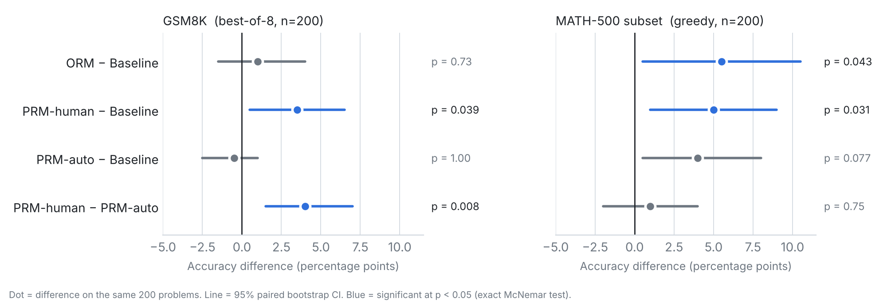

# Beyond Human Annotation: Automated Step Scoring for Process Reward Modelling in Small Language Models

> **Key finding:** Human step labels gave the best GSM8K accuracy (94.5% vs a 91.0% baseline), while GPT-4o mini step labels fell slightly below baseline (90.5%). The LLM-judge rewards barely moved the policy (KL 0.002 vs 0.065), so label quality, not reward design, was the bottleneck.
>
> *On a paired test over the same 200 problems, PRM-human beats the baseline (McNemar p = 0.04) and PRM-auto (p = 0.008). See [Statistical significance](#statistical-significance) for the full comparison and caveats.*

A summer research project comparing three reward strategies for fine-tuning a 7B language model on mathematical reasoning using Group Relative Policy Optimization (GRPO). All training runs on a MacBook Pro M5 Pro (48 GB unified memory) using LoRA and Apple MPS.

---

## Overview

**Research question:** Can automated step-level scoring replace expensive human annotation when training process reward models (PRMs) for mathematical reasoning?

Modern reward model training falls into two camps:

- **Outcome Reward Models (ORM):** Binary signal — did the model get the final answer right?
- **Process Reward Models (PRM):** Step-level signal — is *each reasoning step* correct?

PRMs trained on human annotations (e.g. PRM800K) have been shown to outperform ORMs for best-of-N selection. This project tests whether GPT-4o mini can substitute for human annotators by scoring each reasoning step automatically — removing the annotation bottleneck at the cost of label quality.

---

## Conditions

| ID | Reward signal | Dataset |
|----|--------------|---------|
| **ORM** | Binary outcome (correct / incorrect final answer) | GSM8K / MATH |
| **PRM-human** | Step-level scores from a classifier trained on PRM800K human labels | GSM8K / MATH |
| **PRM-auto** | Step-level scores from GPT-4o mini judging each reasoning step | GSM8K / MATH |

All three conditions share the same base model (Qwen2.5-7B-Instruct), LoRA configuration, GRPO hyperparameters, and training data.

---

## Results

### GSM8K: best-of-8 majority vote (200 test problems)

| Model | Majority-vote [95% CI] | Pass@8 (oracle) |
|-------|:----------------------:|:---------------:|
| Baseline (no fine-tuning) | 91.0% [87.0, 95.0] | 96.0% |
| ORM-GSM8K | 92.0% [88.0, 95.5] | 96.5% |
| **PRM-human-GSM8K** | **94.5% [91.0, 97.5]** | 96.0% |
| PRM-auto-GSM8K | 90.5% [86.5, 94.5] | 95.5% |

PRM-human improves majority-vote accuracy by +3.5pp over baseline and +2.5pp over ORM. PRM-auto falls slightly below baseline, suggesting GPT-4o mini step labels are too noisy to improve on outcome-only rewards.

### MATH-500 subset: greedy decoding (200 of the 500 problems, in-domain training)

| Model | Overall [95% CI] | L1 (n=21) | L2 (n=44) | L3 (n=41) | L4 (n=44) | L5 (n=50) |
|-------|:----------------:|:--:|:--:|:--:|:--:|:--:|
| Baseline | 49.0% [42.0, 56.0] | 20 | 32 | 27 | 15 | 4 |
| ORM-MATH | 54.5% [47.5, 61.5] | 19 | 35 | 27 | **21** | 7 |
| PRM-human-MATH | 54.0% [47.0, 61.0] | 19 | 35 | 27 | 17 | **10** |
| PRM-auto-MATH | 53.0% [46.0, 60.0] | 20 | 35 | 28 | 16 | 7 |

Per-level columns are problems solved. All three conditions improve over baseline by 4 to 5.5pp. ORM gains most on L4 and PRM-human on L5 (4 → 10 of 50), which fits the idea that step-level supervision helps most on long multi-step problems, but the per-level counts are too small to treat as more than a hint.

### Statistical significance

Every model is evaluated on the same problems, so differences are tested with paired methods: a paired bootstrap of the accuracy difference (10,000 resamples) and an exact McNemar test on the problems where the two models disagree. The unpaired CIs above overlap heavily, which understates how consistent the paired differences are. Full output is in [`results/significance.json`](results/significance.json); reproduce with `python src/significance.py`.



| Comparison | Δ accuracy [95% CI] | Wins / losses | McNemar p |
|------------|:-------------------:|:-------------:|:---------:|
| GSM8K: PRM-human vs Baseline | +3.5pp [+0.5, +6.5] | 8 / 1 | 0.039 |
| GSM8K: PRM-human vs ORM | +2.5pp [+0.5, +5.0] | 5 / 0 | 0.062 |
| GSM8K: PRM-human vs PRM-auto | +4.0pp [+1.5, +7.0] | 8 / 0 | 0.008 |
| GSM8K: ORM vs Baseline | +1.0pp [−1.5, +4.0] | 5 / 3 | 0.73 |
| MATH: ORM vs Baseline | +5.5pp [+0.5, +10.5] | 18 / 7 | 0.043 |
| MATH: PRM-human vs Baseline | +5.0pp [+1.0, +9.0] | 14 / 4 | 0.031 |
| MATH: PRM-auto vs Baseline | +4.0pp [+0.5, +8.0] | 12 / 4 | 0.077 |
| MATH: PRM-human vs ORM | −0.5pp [−4.5, +3.5] | 7 / 8 | 1.00 |

What holds up: on GSM8K, PRM-human beats both the baseline and PRM-auto, and the PRM-human vs ORM gap is borderline (p = 0.06). On MATH, GRPO training helps over the baseline, but the three reward types can't be told apart at this sample size.

**Key finding:** on GSM8K, automated step scoring did not replicate the benefit of human-annotated step labels (PRM-human beat PRM-auto, p = 0.008). At this scale, label quality looks like the bottleneck for PRMs rather than the step-level reward shape itself.

### Limitations

- One training seed per condition, so run-to-run variance from GRPO is not measured.
- Evaluation uses 200 problems per benchmark. Differences below roughly 3pp should not be read as real.
- A single base model (Qwen2.5-7B-Instruct) and a single LLM judge (GPT-4o mini) for PRM-auto. A stronger judge might close the gap.
- Training sets are small after filtering (255 GSM8K, 206 MATH problems).

---

## Method

### Training data filtering

The base model already solves ~88% of GSM8K problems correctly, making most problems useless for GRPO (all-correct groups produce zero gradient). A pre-filtering step samples each problem 4 times and keeps only those where the model sometimes succeeds and sometimes fails — guaranteeing a non-trivial reward signal.

- GSM8K: 255 problems retained from the train split
- MATH: 206 problems retained across all 5 difficulty levels and 7 subjects

### GRPO

Group Relative Policy Optimization generates 8 completions per problem, computes per-group advantages, and updates the policy via a clipped surrogate objective with a KL penalty. Key config:

```
group_size         = 8
max_new_tokens     = 384
learning_rate      = 1e-5
kl_coefficient     = 0.05
epochs             = 2
clip_epsilon       = 0.2
```

### LoRA

```
r=16, alpha=32, dropout=0.05
target_modules: q_proj, k_proj, v_proj, o_proj
trainable parameters: ~10M / 7.6B (0.13%)
```

### PRM-human classifier

Qwen2.5-0.5B-Instruct fine-tuned as a sequence classifier on PRM800K boolean step labels. Saved as a PEFT adapter and loaded via `PeftModel.from_pretrained` + `merge_and_unload()` at reward-function time. The classifier is small enough to coexist in memory with the 7B policy model on 48 GB.

### PRM-auto scoring

Each of the 8 completions is judged in a single GPT-4o mini call (all steps batched into one prompt). Eight calls run in parallel via `ThreadPoolExecutor` so API latency doesn't dominate training time. The step score is the fraction of steps judged correct; an outcome bonus (±0.5) is added based on final-answer correctness.

---

## Repo structure

```
src/
  filter_problems.py          # GSM8K mixed-correctness filtering
  filter_math_problems.py     # MATH mixed-correctness filtering
  train_orm.py                # GRPO with binary outcome reward (GSM8K)
  train_orm_math.py           # GRPO with binary outcome reward (MATH)
  train_prm_classifier.py     # PRM800K classifier training
  train_prm.py                # GRPO with PRM-human reward (GSM8K)
  train_prm_math.py           # GRPO with PRM-human reward (MATH)
  train_prm_auto_gsm8k.py     # GRPO with PRM-auto reward (GSM8K)
  train_prm_auto_math.py      # GRPO with PRM-auto reward (MATH)
  evaluate_orm.py             # Single-sample greedy eval (GSM8K)
  evaluate_best_of_n.py       # Best-of-8 majority-vote eval (GSM8K)
  evaluate_math500.py         # Greedy eval on MATH-500
  math_utils.py               # extract_boxed_answer, is_equivalent (sympy)
  reward_functions/
    auto_labels.py            # GPT-4o mini step scoring
results/                      # JSON eval outputs for all conditions
data/
  filtered_gsm8k_problems.json
  filtered_math_problems.json
```

---

## Reproducing

### Requirements

```bash
pip install -r requirements.txt
pip install antlr4-python3-runtime==4.11.0   # required for sympy LaTeX parsing
```

### Environment

Create `.env` with:
```
WANDB_API_KEY=...
OPENAI_API_KEY=...     # only needed for PRM-auto runs
```

### Order of operations

```bash
# 1. Filter training data
caffeinate -i venv/bin/python src/filter_problems.py
caffeinate -i venv/bin/python src/filter_math_problems.py

# 2a. Train ORM
caffeinate -i venv/bin/python src/train_orm.py
caffeinate -i venv/bin/python src/train_orm_math.py

# 2b. Train PRM-human (requires classifier first)
caffeinate -i venv/bin/python src/train_prm_classifier.py
caffeinate -i venv/bin/python src/train_prm.py
caffeinate -i venv/bin/python src/train_prm_math.py

# 2c. Train PRM-auto
caffeinate -i venv/bin/python src/train_prm_auto_gsm8k.py
caffeinate -i venv/bin/python src/train_prm_auto_math.py

# 3. Evaluate
caffeinate -i venv/bin/python src/evaluate_best_of_n.py models/orm-trained
caffeinate -i venv/bin/python src/evaluate_math500.py models/orm-math-trained
```

> **Note:** `caffeinate -i` prevents macOS from sleeping the display, which causes ~14× MPS throughput degradation.

---

## Hardware & compute

| | |
|--|--|
| Hardware | MacBook Pro M5 Pro, 48 GB unified memory |
| Backend | Apple MPS via PyTorch |
| Per-run training time | ~15–16 hours |
| Total compute | ~80 GPU-hours (5 full training runs) |
| PRM-auto API cost | ~$3 (GPT-4o mini, ~12k step-scoring calls) |

---

## References

- Lightman et al. (2023). *Let's Verify Step by Step.* — PRM800K dataset and PRM-human motivation
- Shao et al. (2024). *DeepSeekMath: Pushing the Limits of Mathematical Reasoning in Open Language Models.* — GRPO algorithm
- Qwen Team (2024). *Qwen2.5 Technical Report.*
- HuggingFace TRL — GRPO implementation
